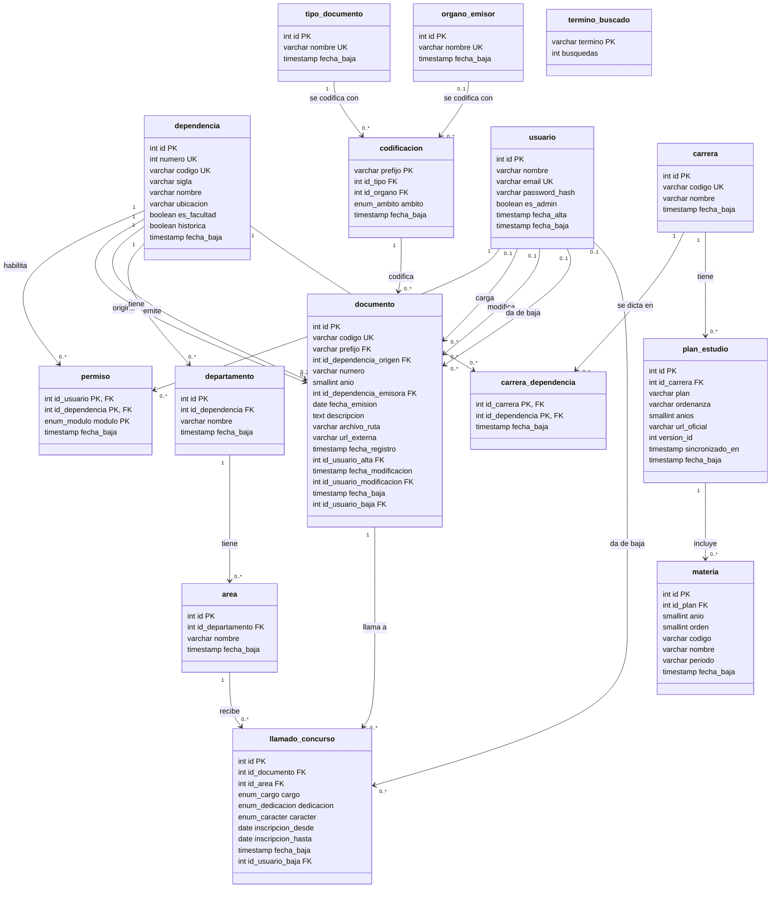

# Base de Datos — Digesto UNSL

Este directorio contiene los scripts y el modelo formal de la base de datos PostgreSQL para el sistema del Digesto Administrativo de la UNSL.

---

## 1. Cómo levantar la base de datos (Instrucciones para el equipo)

### Opción A: Usando pgAdmin 4 (Recomendado)
1. Abrir **pgAdmin 4** y conectarse al servidor local de PostgreSQL.
2. Hacer clic derecho sobre **Databases** > **Create** > **Database...**
3. Nombre de la base de datos: `DigestoUNSL` (o el configurado en tu `.env`) y guardar.
4. Seleccionar la base de datos `DigestoUNSL` en el árbol izquierdo.
5. Abrir la herramienta de consulta: **Tools** > **Query Tool** (o ícono de play/ejecutar).
6. Abrir el archivo `database/BD.sql` (o copiar y pegar todo su contenido en el editor).
7. Presionar **F5** (o el botón **Execute**).
8. ¡Listo! Se habrán creado los tipos `ENUM`, las 15 tablas con sus relaciones e índices, y los datos iniciales de prueba.

### Opción B: Desde la Terminal (psql)
Con la terminal parada en la raíz del proyecto:
```bash
# 1. Crear la base de datos si aún no existe
psql -U postgres -c "CREATE DATABASE \"DigestoUNSL\";"

# 2. Ejecutar el script SQL completo
psql -U postgres -d DigestoUNSL -f database/BD.sql
```

---

## 2. Diagrama Entidad-Relación (MER)



---

## 3. Modelo DBML (para dbdiagram.io)

Si querés ver o editar el diagrama visual en [dbdiagram.io](https://dbdiagram.io/):

```dbml
Table dependencia {
  id int [pk, increment]
  numero int [unique]
  codigo varchar [unique]
  sigla varchar
  nombre varchar
  ubicacion varchar
  es_facultad boolean
  historica boolean
  fecha_baja timestamp
}

Table tipo_documento {
  id int [pk, increment]
  nombre varchar [unique]
  fecha_baja timestamp
}

Table organo_emisor {
  id int [pk, increment]
  nombre varchar [unique]
  fecha_baja timestamp
}

Table codificacion {
  prefijo varchar [pk]
  id_tipo int [not null]
  id_organo int
  ambito varchar
  fecha_baja timestamp
}

Table usuario {
  id int [pk, increment]
  nombre varchar
  email varchar [unique]
  password_hash varchar
  es_admin boolean
  fecha_alta timestamp
  fecha_baja timestamp
}

Table permiso {
  id_usuario int [pk]
  id_dependencia int [pk]
  modulo varchar [pk]
  fecha_baja timestamp
}

Table documento {
  id int [pk, increment]
  codigo varchar [unique]
  prefijo varchar [not null]
  id_dependencia_origen int [not null]
  numero varchar
  anio smallint
  id_dependencia_emisora int [not null]
  fecha_emision date
  descripcion text
  archivo_ruta varchar
  url_externa varchar
  fecha_registro timestamp
  id_usuario_alta int
  fecha_modificacion timestamp
  id_usuario_modificacion int
  fecha_baja timestamp
  id_usuario_baja int
}

Table departamento {
  id int [pk, increment]
  id_dependencia int [not null]
  nombre varchar
  fecha_baja timestamp
}

Table area {
  id int [pk, increment]
  id_departamento int [not null]
  nombre varchar
  fecha_baja timestamp
}

Table llamado_concurso {
  id int [pk, increment]
  id_documento int [not null]
  id_area int [not null]
  cargo varchar
  dedicacion varchar
  caracter varchar
  inscripcion_desde date
  inscripcion_hasta date
  fecha_baja timestamp
  id_usuario_baja int
}

Table carrera {
  id int [pk, increment]
  codigo varchar [unique]
  nombre varchar
  fecha_baja timestamp
}

Table carrera_dependencia {
  id_carrera int [pk]
  id_dependencia int [pk]
  fecha_baja timestamp
}

Table plan_estudio {
  id int [pk, increment]
  id_carrera int [not null]
  plan varchar
  ordenanza varchar
  anios smallint
  url_oficial varchar
  version_id int
  sincronizado_en timestamp
  fecha_baja timestamp
}

Table materia {
  id int [pk, increment]
  id_plan int [not null]
  anio smallint
  orden smallint
  codigo varchar
  nombre varchar
  periodo varchar
  fecha_baja timestamp
}

Table termino_buscado {
  termino varchar [pk]
  busquedas int
}

Ref: codificacion.id_tipo > tipo_documento.id
Ref: codificacion.id_organo > organo_emisor.id
Ref: permiso.id_usuario > usuario.id
Ref: permiso.id_dependencia > dependencia.id
Ref: documento.prefijo > codificacion.prefijo
Ref: documento.id_dependencia_origen > dependencia.id
Ref: documento.id_dependencia_emisora > dependencia.id
Ref: documento.id_usuario_alta > usuario.id
Ref: documento.id_usuario_modificacion > usuario.id
Ref: documento.id_usuario_baja > usuario.id
Ref: departamento.id_dependencia > dependencia.id
Ref: area.id_departamento > departamento.id
Ref: llamado_concurso.id_documento > documento.id
Ref: llamado_concurso.id_area > area.id
Ref: llamado_concurso.id_usuario_baja > usuario.id
Ref: carrera_dependencia.id_carrera > carrera.id
Ref: carrera_dependencia.id_dependencia > dependencia.id
Ref: plan_estudio.id_carrera > carrera.id
Ref: materia.id_plan > plan_estudio.id
```
