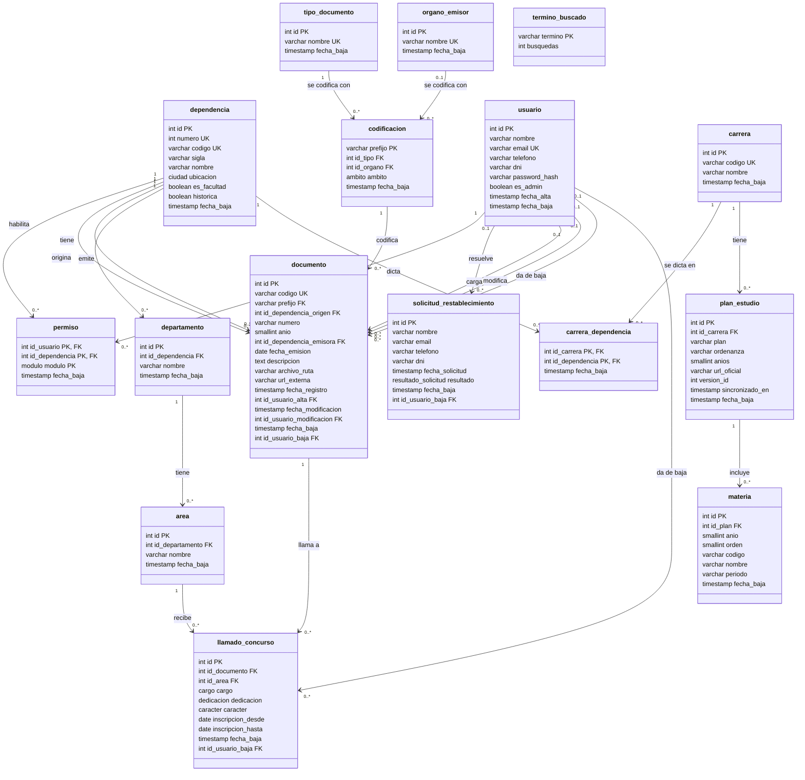

# Base de Datos — Digesto UNSL

Este directorio contiene los scripts y el modelo formal de la base de datos PostgreSQL para el sistema del Digesto Administrativo de la UNSL.

---

## 1. Cómo levantar la base de datos (Instrucciones para el equipo)

`schema.sql` empieza creando la base `DigestoUNSL` y conectándose a ella, como el proyecto de muestra
de la cátedra; después crea los tipos `ENUM`, las 16 tablas con sus relaciones y los índices.
`seed.sql` carga los datos iniciales y de prueba.

### Opción A: Usando pgAdmin 4
1. Abrir **pgAdmin 4** y conectarse al servidor local de PostgreSQL.
2. Hacer clic derecho sobre **Databases** > **Create** > **Database...**
3. Nombre de la base de datos: `DigestoUNSL` (o el configurado en tu `.env`) y guardar.
4. Hacer clic derecho sobre **DigestoUNSL** > **Query Tool** (siempre sobre esa base, no sobre `postgres`).
5. Abrir el archivo `database/schema.sql`, seleccionar desde la línea siguiente a `\c "DigestoUNSL"`
   hasta el final y presionar **F5**.
6. Abrir el archivo `database/seed.sql` y presionar **F5**.

> En pgAdmin **no** se puede ejecutar `schema.sql` entero: la línea `\c` es un comando exclusivo de
> `psql` y pgAdmin no la entiende. Por eso la base se crea desde el menú y se saltean las primeras líneas.

### Opción B: Desde la Terminal (psql)
Con la terminal parada en la raíz del proyecto:
```bash
psql -U postgres -f database/schema.sql
psql -U postgres -d DigestoUNSL -f database/seed.sql
```

Si la base ya existía, `schema.sql` avisa que la base de datos «DigestoUNSL» ya existe y sigue con el
resto: no es un problema.

### Carga completa (después del seed)

El seed deja solo unos pocos documentos de prueba. Para tener los datos reales del Digesto (documentos,
llamados a concurso, carreras, planes y materias) se corren, uno por uno y en este orden, los archivos de
la carga. Se corren con la terminal parada en `backend_node/`, porque ahí está la copia de la carga:
`backend_node/Digesto-datos/` (fuera de git).

1. Documentos, llamados, carreras, planes y materias (una sola transacción):

```bash
psql -d DigestoUNSL -v ON_ERROR_STOP=1 -f Digesto-datos/digesto.sql
```

2. Rutas de los PDF (`archivo_ruta` de los documentos que tienen archivo):

```bash
psql -d DigestoUNSL -v ON_ERROR_STOP=1 -f Digesto-datos/digesto-archivos.sql
```

3. Estadísticas de la base, para que las consultas usen bien los índices:

```bash
psql -d DigestoUNSL -c "ANALYZE;"
```

Los dos archivos se pueden volver a correr sin problema (usan `ON CONFLICT`). Los PDF están en
`Digesto-datos/archivos`, y esa es la carpeta que usa el back con la variable `ARCHIVOS_DIR` de
`backend_node/.env`.

### Base ya creada (columnas nuevas de `usuario`)

`schema.sql` ya trae `telefono` y `dni` en `usuario`. Si la base se creó antes de ese cambio, se agregan
una sola vez, sin perder datos:

```sql
ALTER TABLE usuario ADD COLUMN IF NOT EXISTS telefono VARCHAR(30);
ALTER TABLE usuario ADD COLUMN IF NOT EXISTS dni VARCHAR(8);
```

La tabla `solicitud_restablecimiento`, el tipo `resultado_solicitud` y los índices nuevos de `documento`
se crean volviendo a correr `schema.sql` (usa `IF NOT EXISTS`).

---

## 2. Diagrama Entidad-Relación (MER)



---

## 3. Modelo DBML (para dbdiagram.io)

Si querés ver o editar el diagrama visual en [dbdiagram.io](https://dbdiagram.io/):

```dbml
Enum ciudad {
  "San Luis"
  "Villa Mercedes"
  Merlo
}

Enum ambito {
  universidad
  facultad
  escuela
}

Enum modulo {
  documentos
  concursos
}

Enum resultado_solicitud {
  restablecida
  rechazada
}

Enum cargo {
  "Profesores Titulares"
  "Profesores Asociados"
  "Profesores Adjuntos"
  "Jefes de Trabajos Practicos"
  "Auxiliares de Primera"
  "Auxiliares de Segunda"
  "Agregados Ad-Honorem Alumnos"
  "Agregados Ad-Honorem Diplomados"
  Varios
}

Enum dedicacion {
  Exclusivos
  Semiexclusivos
  Simples
  Completos
  Varias
}

Enum caracter {
  Efectivos
  Interinos
  Suplentes
  Temporarios
  Reemplazantes
  Contratados
  Varios
}

Table dependencia {
  id int [pk, increment]
  numero int [unique]
  codigo varchar(10) [unique]
  sigla varchar(20) [not null]
  nombre varchar(150) [not null]
  ubicacion ciudad
  es_facultad boolean [not null, default: false]
  historica boolean [not null, default: false]
  fecha_baja timestamp
}

Table tipo_documento {
  id int [pk, increment]
  nombre varchar(50) [not null, unique]
  fecha_baja timestamp
}

Table organo_emisor {
  id int [pk, increment]
  nombre varchar(100) [not null, unique]
  fecha_baja timestamp
}

Table codificacion {
  prefijo varchar(10) [pk]
  id_tipo int [not null]
  id_organo int
  ambito ambito
  fecha_baja timestamp
}

Table usuario {
  id int [pk, increment]
  nombre varchar(100) [not null]
  email varchar(150) [not null, unique]
  telefono varchar(30)
  dni varchar(8)
  password_hash varchar(255) [not null]
  es_admin boolean [not null, default: false]
  fecha_alta timestamp [not null, default: `now()`]
  fecha_baja timestamp
}

Table solicitud_restablecimiento {
  id int [pk, increment]
  nombre varchar(100) [not null]
  email varchar(150) [not null]
  telefono varchar(30) [not null]
  dni varchar(8) [not null]
  fecha_solicitud timestamp [not null, default: `now()`]
  resultado resultado_solicitud
  fecha_baja timestamp
  id_usuario_baja int
  indexes {
    `lower(email)` [unique, note: 'Parcial: WHERE fecha_baja IS NULL']
  }
  checks {
    `(fecha_baja IS NULL) = (resultado IS NULL)` [name: 'ck_solicitud_resultado']
  }
}

Table permiso {
  id_usuario int [not null]
  id_dependencia int [not null]
  modulo modulo [not null]
  fecha_baja timestamp
  indexes {
    (id_usuario, id_dependencia, modulo) [pk]
  }
}

Table documento {
  id int [pk, increment]
  codigo varchar(30) [not null, unique]
  prefijo varchar(10) [not null]
  id_dependencia_origen int [not null]
  numero varchar(10) [not null]
  anio smallint [not null]
  id_dependencia_emisora int [not null]
  fecha_emision date
  descripcion text
  archivo_ruta varchar(255)
  url_externa varchar(255)
  fecha_registro timestamp [not null, default: `now()`]
  id_usuario_alta int
  fecha_modificacion timestamp
  id_usuario_modificacion int
  fecha_baja timestamp
  id_usuario_baja int
  indexes {
    fecha_emision
    fecha_registro
    (prefijo, numero, anio)
    (anio, id)
    id_dependencia_emisora
    id_dependencia_origen
  }
}

Table departamento {
  id int [pk, increment]
  id_dependencia int [not null]
  nombre varchar(150) [not null]
  fecha_baja timestamp
  indexes {
    (id_dependencia, nombre) [unique]
  }
}

Table area {
  id int [pk, increment]
  id_departamento int [not null]
  nombre varchar(150) [not null]
  fecha_baja timestamp
  indexes {
    (id_departamento, nombre) [unique]
  }
}

Table llamado_concurso {
  id int [pk, increment]
  id_documento int [not null]
  id_area int [not null]
  cargo cargo [not null]
  dedicacion dedicacion
  caracter caracter [not null]
  inscripcion_desde date [not null]
  inscripcion_hasta date [not null]
  fecha_baja timestamp
  id_usuario_baja int
  indexes {
    inscripcion_hasta
    (id_documento, id_area, cargo, dedicacion, caracter, inscripcion_desde) [unique]
  }
}

Table carrera {
  id int [pk, increment]
  codigo varchar(10) [not null, unique]
  nombre varchar(200) [not null]
  fecha_baja timestamp
}

Table carrera_dependencia {
  id_carrera int [not null]
  id_dependencia int [not null]
  fecha_baja timestamp
  indexes {
    (id_carrera, id_dependencia) [pk]
  }
}

Table plan_estudio {
  id int [pk, increment]
  id_carrera int [not null]
  plan varchar(20) [not null]
  ordenanza varchar(50) [not null]
  anios smallint [not null]
  url_oficial varchar(500) [not null]
  version_id int [not null]
  sincronizado_en timestamp [not null]
  fecha_baja timestamp
  indexes {
    (id_carrera, plan) [unique]
  }
}

Table materia {
  id int [pk, increment]
  id_plan int [not null]
  anio smallint [not null]
  orden smallint [not null]
  codigo varchar(20) [not null]
  nombre varchar(200) [not null]
  periodo varchar(50)
  fecha_baja timestamp
  indexes {
    (id_plan, anio, codigo) [unique]
  }
}

Table termino_buscado {
  termino varchar(200) [pk]
  busquedas int [not null, default: 0]
}

TableGroup catalogos {
  dependencia
  tipo_documento
  organo_emisor
  codificacion
  departamento
  area
}

TableGroup usuarios {
  usuario
  solicitud_restablecimiento
  permiso
}

TableGroup documentos_y_concursos {
  documento
  llamado_concurso
}

TableGroup planes_de_estudio {
  carrera
  carrera_dependencia
  plan_estudio
  materia
}

TableGroup estadisticas {
  termino_buscado
}

Ref: codificacion.id_tipo > tipo_documento.id
Ref: codificacion.id_organo > organo_emisor.id
Ref: solicitud_restablecimiento.id_usuario_baja > usuario.id
Ref: permiso.id_usuario > usuario.id
Ref: permiso.id_dependencia > dependencia.id
Ref: documento.prefijo > codificacion.prefijo
Ref: documento.id_dependencia_origen > dependencia.id
Ref: documento.id_dependencia_emisora > dependencia.id
Ref: documento.id_usuario_alta > usuario.id
Ref: documento.id_usuario_modificacion > usuario.id
Ref: documento.id_usuario_baja > usuario.id
Ref: departamento.id_dependencia > dependencia.id
Ref: area.id_departamento > departamento.id
Ref: llamado_concurso.id_documento > documento.id
Ref: llamado_concurso.id_area > area.id
Ref: llamado_concurso.id_usuario_baja > usuario.id
Ref: carrera_dependencia.id_carrera > carrera.id
Ref: carrera_dependencia.id_dependencia > dependencia.id
Ref: plan_estudio.id_carrera > carrera.id
Ref: materia.id_plan > plan_estudio.id
```
